[中文](README.md) · [Portfolio](https://xiaosang.cc/)

# holynova · Projects

## Project directory

| Project | Preview | Description | Links |
|---|---|---|---|
| AI Coding Thinkers · Zara / poteto / Pocock | 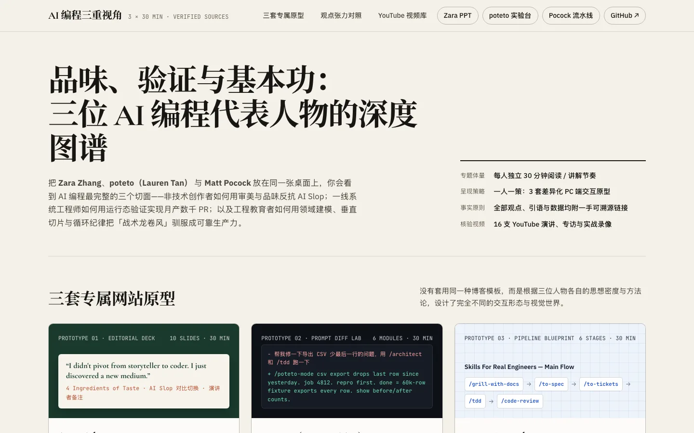 | Source-bound PC showcase of Zara Zhang, poteto (Lauren Tan), and Matt Pocock with 16 verified YouTube talks across three 30-minute interactive formats: editorial slide deck, Prompt Diff lab, and engineering pipeline blueprint. | [Demo](https://ai-coding-thinkers.xiaosang.cc/) · [Repo](https://github.com/holynova/ai-coding-thinkers) |
| Hong Kong Food Map & Guide | 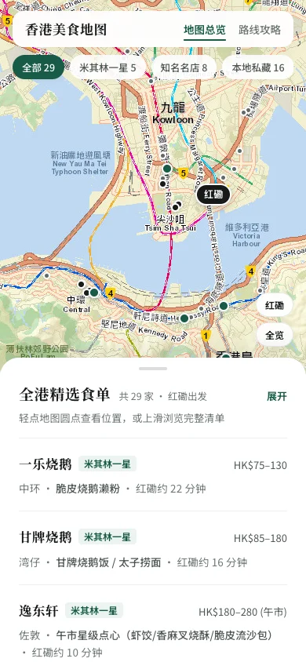 | Mobile-first Hong Kong food map featuring 29 vetted spots—5 affordable 1-Michelin-star eateries, 8 iconic classics, and 16 local favorites—with itineraries and one-tap navigation. | [Demo](https://hk-food-guide.xiaosang.cc/) · [Repo](https://github.com/holynova/hk-food-guide) |
| Woool Survivor Mobile | 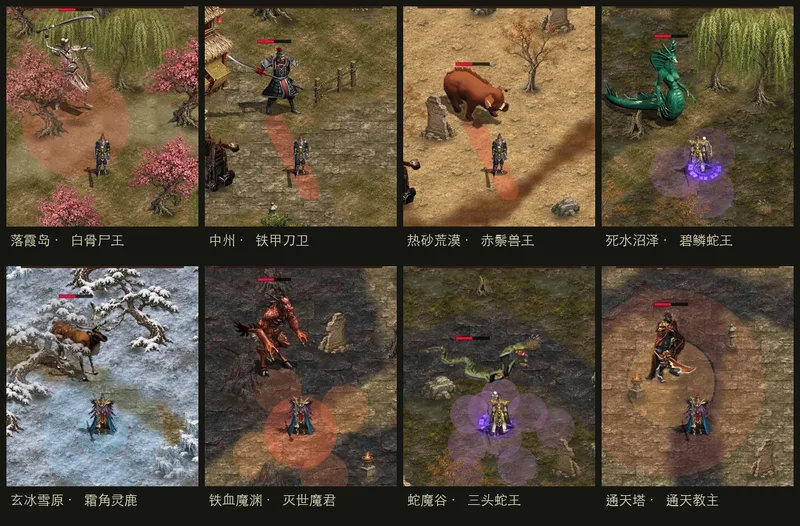 | Dodge with one finger through eight boss chapters. Version 1.1 adds two boss trials and keeps classic saves separate. | [Demo](https://xiaosang.cc/woool-survivor-mobile/next/) · [Repo](https://github.com/holynova/woool-survivor-mobile) |
| Piano Fireworks | 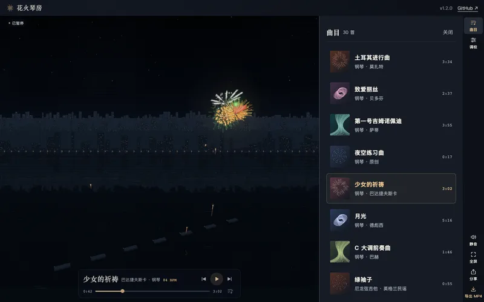 | Choose from 55 recordings and watch fireworks respond to piano notes, ice sounds and snare drums. | [Demo](https://piano-fireworks.xiaosang.cc/) · [Repo](https://github.com/holynova/piano-fireworks) |
| Sort Lab | 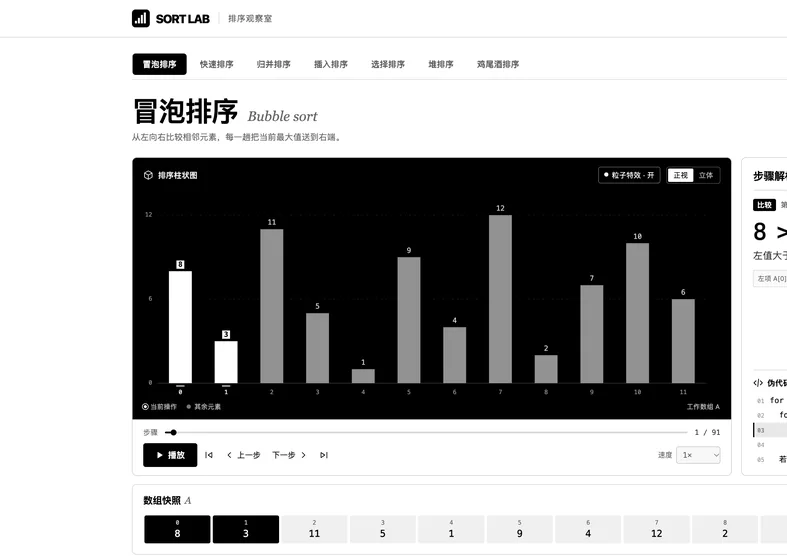 | Step through seven algorithms with solid bars, array snapshots, pseudocode and sound. | [Demo](https://sort-animation.xiaosang.cc/) · [Repo](https://github.com/holynova/sort_animation) |
| DO IT! · Verb Theater | 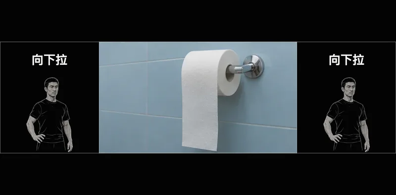 | Follow ten gestures through a filmed sequence. One downward pull opens blinds, unrolls paper or switches on a light. | [Demo](https://verb-theater.xiaosang.cc/) · [Repo](https://github.com/holynova/verb-theater) |
| Bramble Brawl | 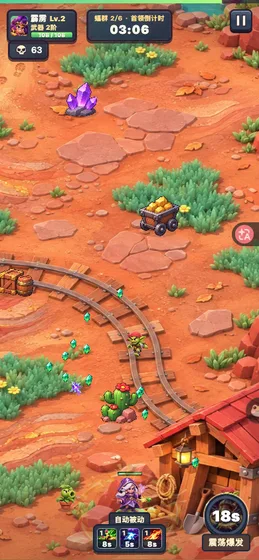 | Dodge the horde with a cactus hero, evolve weapons and passives, and take on the mine boss. | [Demo](https://bramble-brawl.xiaosang.cc/) · [Repo](https://github.com/holynova/bramble-brawl) |
| Two-Word Radio |  | Press Space to tune in to a band name and its melody. Two lists of 308 words yield 94,864 pairings. | [Demo](https://band-name-radio.xiaosang.cc/) · [Repo](https://github.com/holynova/band-name-radio) |
| AI Slop Field Guide | 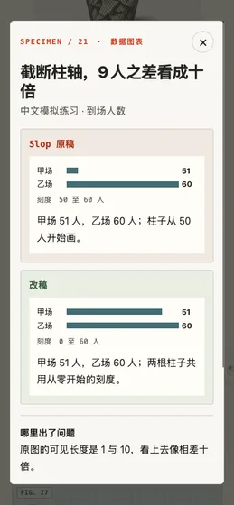 | Compare 60 Chinese examples and their revisions, including eight linked to real events or studies. | [Demo](https://ai-slop-fieldguide.xiaosang.cc/) · [Repo](https://github.com/holynova/ai-slop-fieldguide) |
| Ucas Particle Lab | 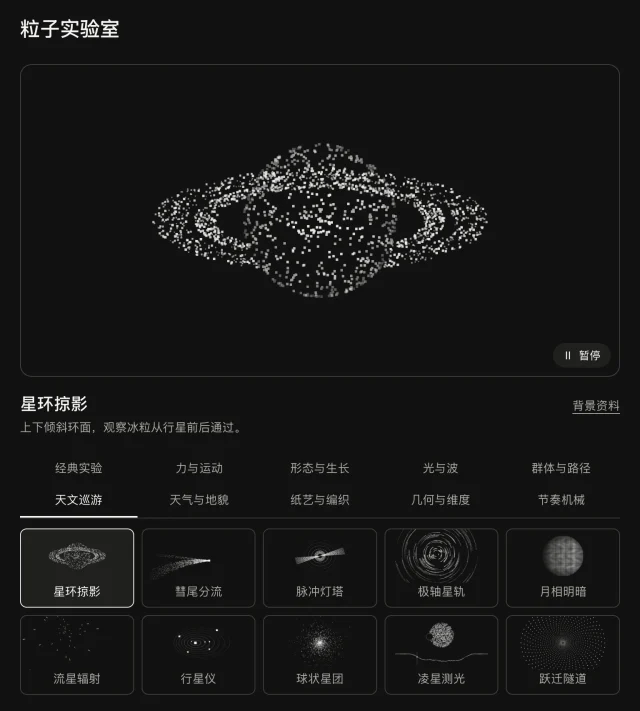 | Five Ucas Studio motion studies and 100 interactive particle experiments. Tilt planetary rings, turn a crank or adjust a moiré pattern. | [Demo](https://ucas-particles.xiaosang.cc/) · [Repo](https://github.com/holynova/ucas-particles) |
| Beyond the Print | 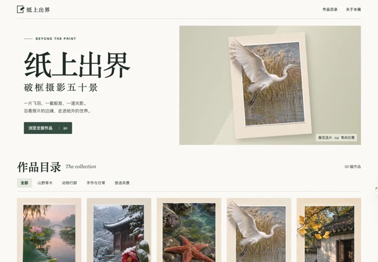 | Fifty original AI out-of-frame photographs in a browsable exhibition with subject filters and full-resolution prints. | [Demo](https://beyond-the-print.xiaosang.cc/) · [Repo](https://github.com/holynova/beyond-the-print) |
| Win95 Layout Atlas | 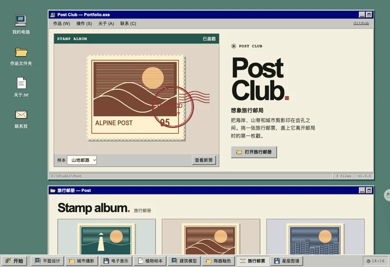 | Ten Windows 95 layout studies with real previews, a comparison guide, and side-by-side examples using the same material. | [Demo](https://win95-desktop-atlas.xiaosang.cc/) · [Repo](https://github.com/holynova/win95-desktop-atlas) |
| Preference Atlas |  | Rate 96 Chinese writing and visual design samples across eight topics and copy a personal style guide into your AI. | [Demo](https://preference-atlas.xiaosang.cc/) · [Repo](https://github.com/holynova/preference-atlas) |
| Parenting Reader | 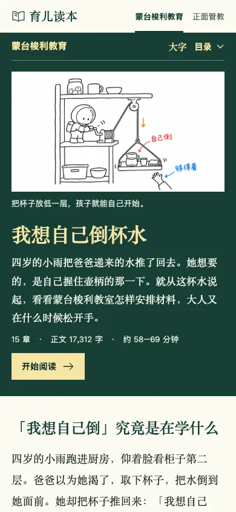 | Two illustrated Chinese essays on Montessori education and Positive Discipline, with age-specific examples from everyday family life. Each takes about an hour to read. | [Demo](https://parenting-reader.xiaosang.cc/) · [Repo](https://github.com/holynova/parenting-reader) |
| Gravity Watch Face |  | Mobile-first 3D physics interactive playground with responsive fullscreen, distraction-free view, regulation basketball court, five PBR scenes, and layered haptics. | [Demo](https://gravity-watch-face.xiaosang.cc/) · [Repo](https://github.com/holynova/gravity-watch-face) |
| First Three Years: 0–3 Parenting Guide | 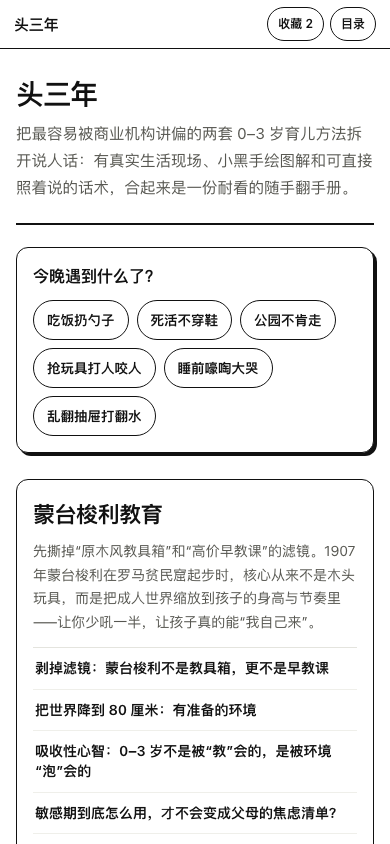 | Mobile-first 0–3 parenting handbook covering Montessori (7 chapters) and Positive Discipline (6 chapters), 23 hand-drawn illustrations, and interactive crisis scripts. | [Demo](https://first-three-years.xiaosang.cc/) · [Repo](https://github.com/holynova/first-three-years) |
| Gamefolio | 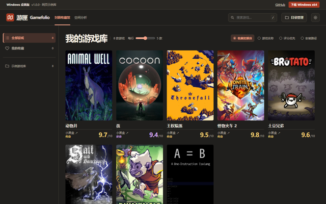 | A Windows game library with cover-based launching, ratings, a disk usage map and archived game discovery. | [Demo](https://game-shelf.xiaosang.cc/) · [Repo](https://github.com/holynova/game-shelf) |
| Wujun Study |  | 42 thematic guides to 14 Wu Jun courses, with 17 reviewed Chinese comic slide decks of 15 pages each, full-text search, traceable sources and PDF downloads. | [Demo](https://wujun-study.xiaosang.cc/) · [Repo](https://github.com/holynova/wujun-study) |
| Shanghai Metro Night |  | Shanghai Metro Night: a full-screen map with opening-and-closing films, timed announcements and light/dark themes across 14 lines and 338 stations | [Demo](https://xiaosang.cc/shanghai-metro-night/) · [Repo](https://github.com/holynova/shanghai-metro-night) |
| xiaosang AI Gallery |  | A unified gallery of 3,666 images across 22 collections, with grouped posts, filters, full-screen swiping, downloads, and reusable prompts. | [Demo](https://gallery.xiaosang.cc/) · [Repo](https://github.com/holynova/xiaosang-gallery) |
| Token Theater | 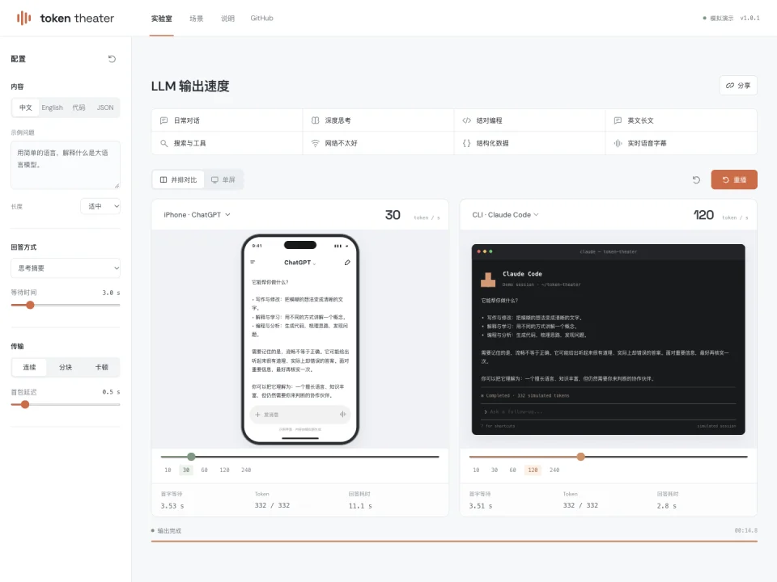 | Compare LLM streaming speed, first-token delay, and delivery cadence across mobile, terminal, web, and desktop interfaces. | [Demo](https://xiaosang.cc/token-theater/) · [Repo](https://github.com/holynova/token-theater) |
| Plant Survivors |  | Visit Dave’s camp for the guide, upgrades, plant unlocks and tutorial. Choose your hero and fight endless waves across three maps. | [Demo](https://xiaosang.cc/plant-survivors-ui/) · [Repo](https://github.com/holynova/plant-survivors-ui) |
| VPN Ledger | 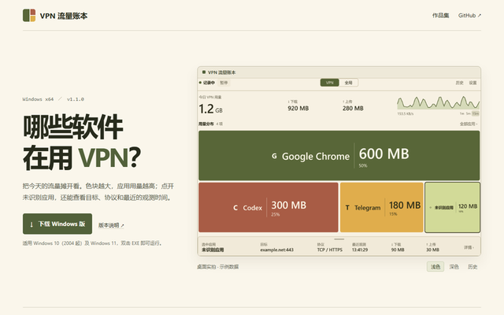 | Track per-app VPN or system-wide traffic on Windows, inspect unidentified connections, and browse local history. | [下载](https://vpn-ledger.xiaosang.cc/) · [Repo](https://github.com/holynova/vpn-ledger) |
| Hotspot Ledger |  | Local macOS hotspot monitoring with interface usage, process activity, alerts, optional disconnection and session resumption. | [Demo](https://xiaosang.cc/hotspot-ledger/) · [Repo](https://github.com/holynova/hotspot-ledger) |
| Pingye |  | Make personal, product, and city posters with nine layouts, direct image cropping, and high-resolution PNG export. | [Demo](https://xiaosang.cc/pingye/) · [Repo](https://github.com/holynova/pingye) |
| Photo Breakout |  | Create breakout photos with on-device portrait segmentation, adjustable white grids, a quick guide, local history, and PNG export. | [Demo](https://xiaosang.cc/photo-breakout/) · [Repo](https://github.com/holynova/photo-breakout) |
| Photo Atlas | 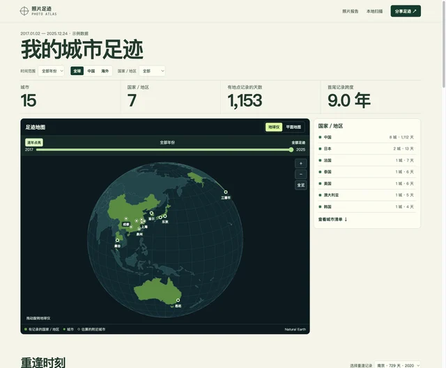 | Scan photos locally to map visits, reunions, and home bases in a travel yearbook with administrative boundaries. | [Demo](https://xiaosang.cc/photo-atlas/) · [Repo](https://github.com/holynova/photo-atlas) |
| X Bookmark Recall | 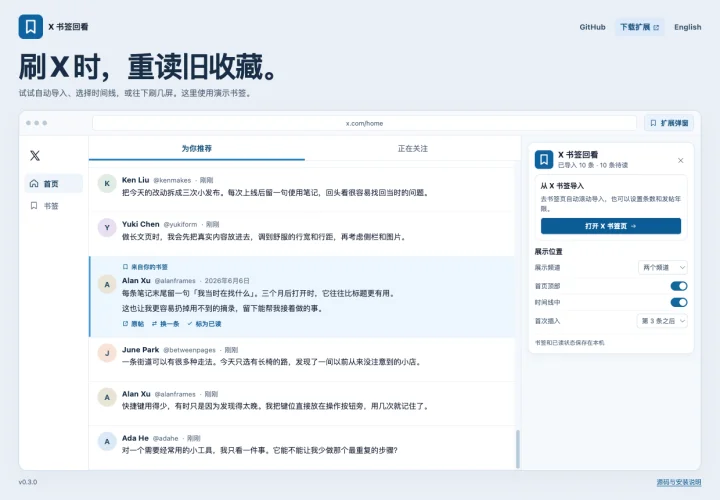 | Automatically imports X bookmarks and resurfaces them in For You and Following | [Demo](https://xiaosang.cc/x-bookmark-recall/) · [Repo](https://github.com/holynova/x-bookmark-recall) |
| Bernstein Ypc | 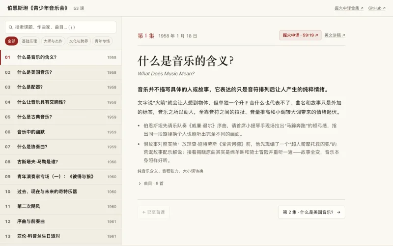 | Two-column study guide to all 53 Young People's Concerts with live search, category filters, Bilibili links, and playable repertoire previews. | [Demo](https://xiaosang.cc/bernstein-ypc/) · [Repo](https://github.com/holynova/bernstein-ypc) |
| Woool Survivor Game | 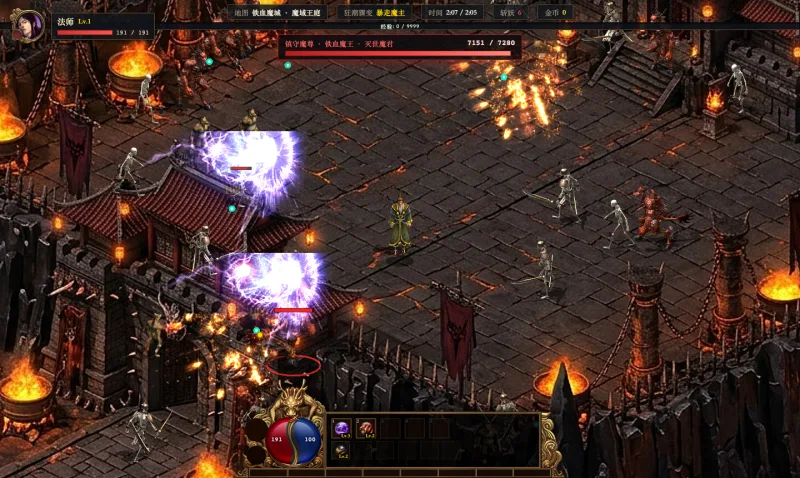 | Legend of World (Woool) survivor roguelite with Warrior/Mage/Taoist builds, authentic sprites, six isometric city maps and four sawtooth difficulty curves. | [Demo](https://xiaosang.cc/woool-survivor-game/) · [Repo](https://github.com/holynova/woool-survivor-game) |
| X Prompt Library | 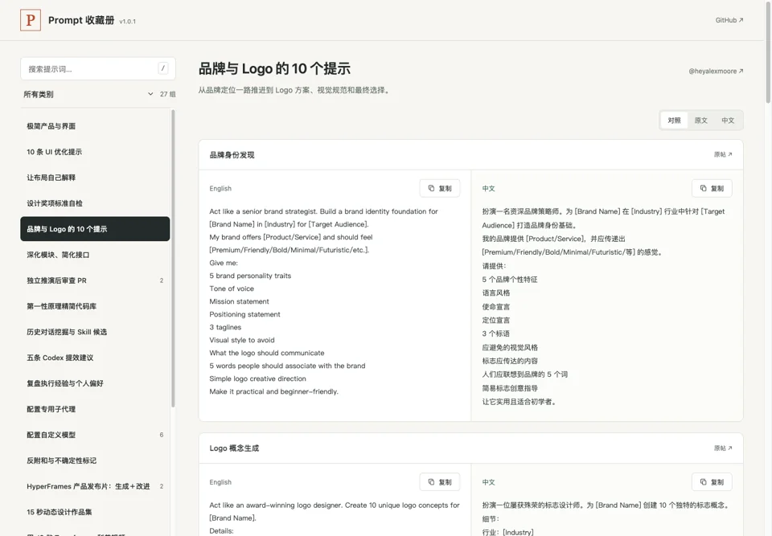 | 71 AI prompts in 27 collections, with original text, 28 Chinese translations, category search and independent copy buttons. | [Demo](https://xiaosang.cc/x-prompt-library/) · [Repo](https://github.com/holynova/x-prompt-library) |
| Concept Atlas |  | 121 illustrated explainers for familiar words with unfamiliar mechanics, with category filters, search and original PNG downloads. | [Demo](https://xiaosang.cc/concept-atlas/) · [Repo](https://github.com/holynova/concept-atlas) |
| Mafa Survivor |  | Mobile-first Mafa Survivor: three classes, 33 eight-rank skills, ten maps and final bosses. Original mode retained. | [Demo](https://xiaosang.cc/mafa-survivor/) · [Repo](https://github.com/holynova/mafa-survivor) |
| World Unsolved Mysteries | 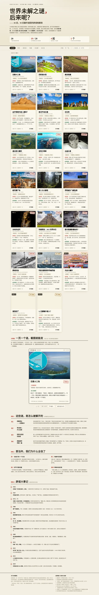 | World unsolved mysteries: 20 childhood mysteries from the 80s and 90s, with debunking verdicts and hard evidence | [Demo](https://holynova.github.io/world-unsolved-mysteries/) · [Repo](https://github.com/holynova/world-unsolved-mysteries) |
| Baking Variable Search |  | Baking variable search: faceted multi-select search across 60 bakes, with live counts that update as you pick | [Demo](https://holynova.github.io/baking-variable-search/) · [Repo](https://github.com/holynova/baking-variable-search) |
| Baking Encyclopedia |  | Baking encyclopedia: 36 bakes decoded through six variables, explaining the logic behind the odd names | [Demo](https://holynova.github.io/baking-encyclopedia/) · [Repo](https://github.com/holynova/baking-encyclopedia) |
| Paper in Motion | 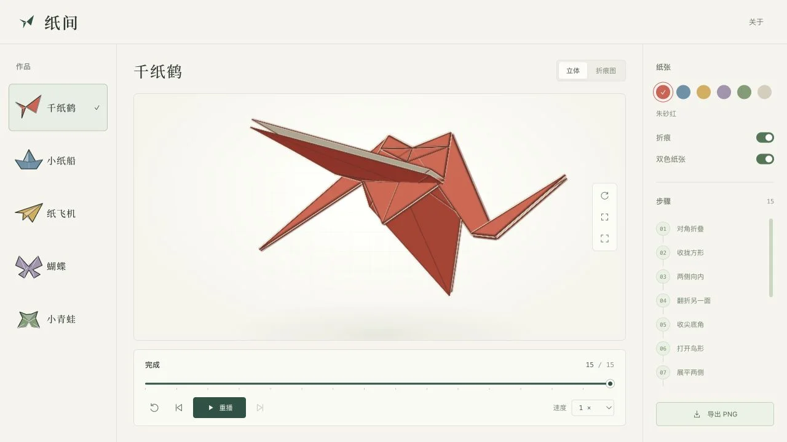 | Explore five classic origami models in 3D with step playback, clear creases, paper colors, crease patterns and PNG export. | [Demo](https://xiaosang.cc/origami-studio/) · [Repo](https://github.com/holynova/origami-studio) |
| Fourier Atlas | 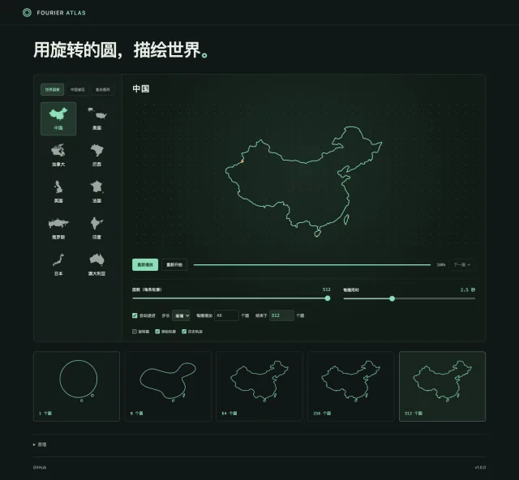 | Draw maps and Four Symbols tile motifs with Fourier epicycles, highlighted circles, a clean view and progressive detail. | [Demo](https://xiaosang.cc/fourier-atlas/) · [Repo](https://github.com/holynova/fourier-atlas) |
| Rock In Pictures | 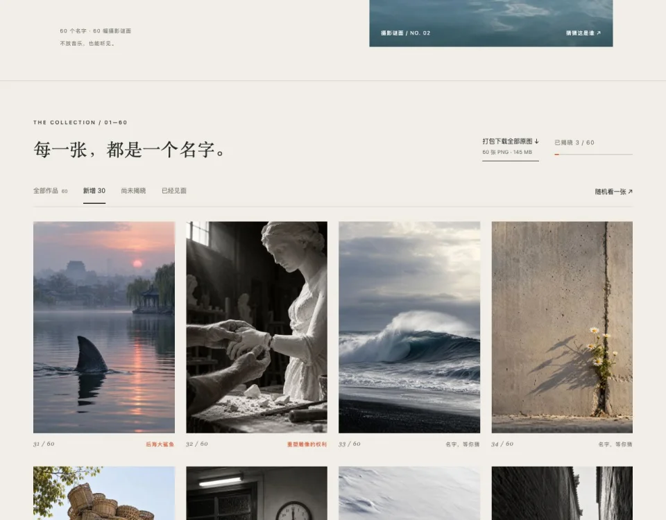 | Sound in Sight: guess 60 Chinese bands from photographic riddles, with instant reveals, clues, and single-image downloads. | [Demo](https://xiaosang.cc/rock-in-pictures/) · [Repo](https://github.com/holynova/rock-in-pictures) |
| Podcast Atlas |  | A podcast reading library with separate topic collections, keyword search, and articles published before illustrated Chinese slide decks. | [Demo](https://xiaosang.cc/podcast-atlas/) · [Repo](https://github.com/holynova/podcast-atlas) |
| Classic Books Guide (112 Verified Books) |  | Curated reading guides for 112 verified classic books across 8 domains with authentic chapter fidelity and real-world examples | [Demo](https://xiaosang.cc/forty-classic-books/) · [Repo](https://github.com/holynova/forty-classic-books) |
| Up Series 70 Years |  | Documentary archive tracing 14 lives across 63 years from age 7 to 70 with complete timelines and profiles | [Demo](https://xiaosang.cc/up-series-70years/) · [Repo](https://github.com/holynova/up-series-70years) |
| 24 Solver |  | Single-file 24-point poker solver: custom or random deal with algebraic deduplication and card animations | [Demo](https://xiaosang.cc/24-solver/) · [Repo](https://github.com/holynova/24-solver) |
| Doraemon House 3D | 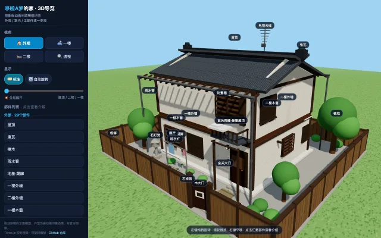 | Interactive 3D walk-through of Nobita Nobi's house from Doraemon built with Three.js with exploded floor views | [Demo](https://xiaosang.cc/doraemon-house-3d/) · [Repo](https://github.com/holynova/doraemon-house-3d) |
| Video Gallery |  | Six short films made with AI artwork, Remotion and Motion Canvas. | [Demo](https://xiaosang.cc/video-gallery/) · [Repo](https://github.com/holynova/video-gallery) |
| Neon Survivors |  | Neon Survivors — a Three.js 3D survivor roguelite with procedural models and synthesized audio | [Demo](https://xiaosang.cc/neon-survivors/) · [Repo](https://github.com/holynova/neon-survivors) |
| Tuber Survivors | 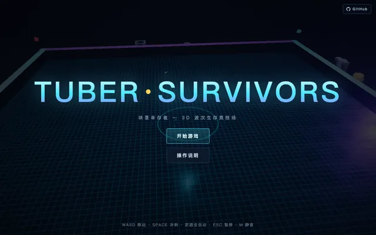 | Game experiment: Tuber Survivors — 3D wave combat, multi-weapon loadouts and between-wave shops | [Demo](https://xiaosang.cc/tuber-survivors/) · [Repo](https://github.com/holynova/tuber-survivors) |
| Spud Squad | 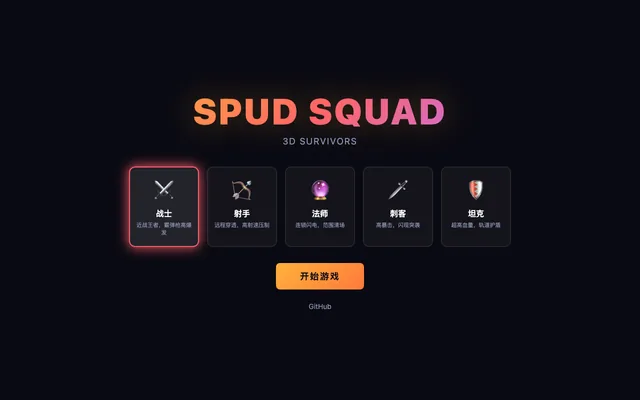 | Game experiment: Spud Squad — a Three.js 3D survivor arena with multiple character classes | [Demo](https://xiaosang.cc/spud-squad/) · [Repo](https://github.com/holynova/spud-squad) |
| Game Narrative Archive | 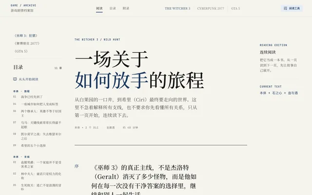 | Story Atlas — mobile-first game-story reading with character relationships, choices and ending analysis | [Demo](https://xiaosang.cc/game-narrative-archive/) · [Repo](https://github.com/holynova/game-narrative-archive) |
| Web Survivor Game Agy | 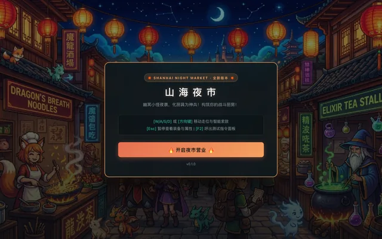 | Shanhai Night Market — a Chinese-fantasy survivor game with kitchen-tool and flavor-based combat builds | [Demo](https://xiaosang.cc/demos/web-survivor-game-agy/) · [Repo](https://github.com/holynova/web-survivor-game-agy) |
| Time Slider Clock | 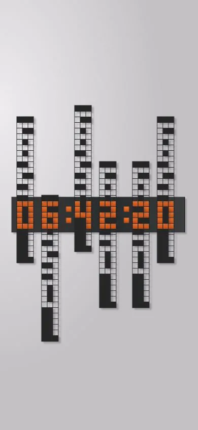 | Perforated-grid clock with column, whole-digit, original dual rails and a 5×5 perforated alphabet rails, seconds, neon themes and accelerated testing | [Demo](https://xiaosang.cc/time-slider-clock/) · [Repo](https://github.com/holynova/time-slider-clock) |
| Dihao · Imperial Name Decoder | 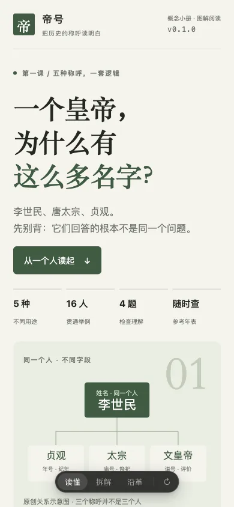 | Mobile-first guide to imperial naming with 16 rulers, 32 era records, source-linked comparisons and quizzes. | [Demo](https://dihao.xiaosang.cc/) · [Repo](https://github.com/holynova/dihao) |
| Translucent Toy Guard | 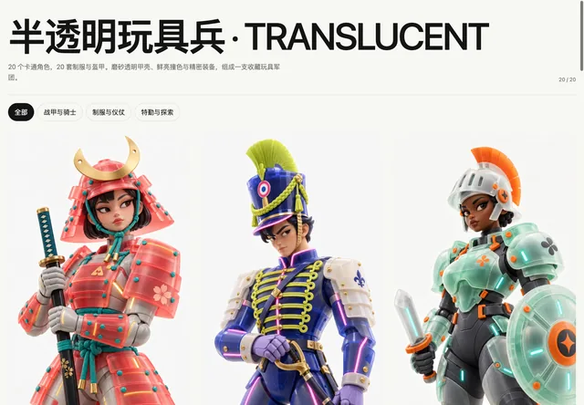 | Twenty cartoon collectible guards with frosted translucent armor, rigid uniforms and vibrant palettes, with category filters, large previews and sharing. | [Demo](https://translucent-toy-guard.xiaosang.cc/) · [Repo](https://github.com/holynova/translucent-toy-guard) |
| Shanhe Gallery | 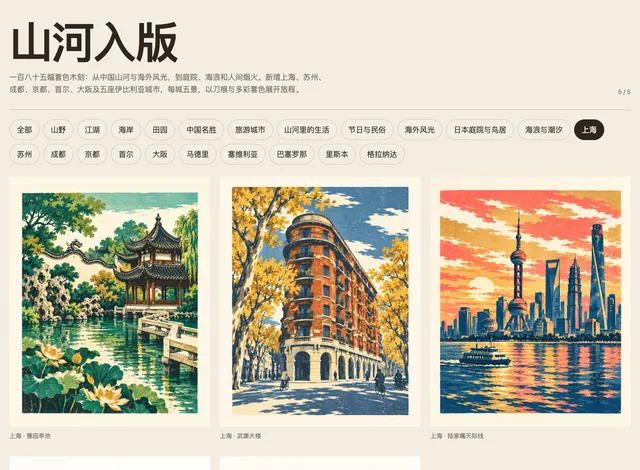 | 185 original AI woodcut-style artworks: landscapes, landmarks, daily life, festivals and five scenes from eleven cities, with filters, lightbox and downloads. | [Demo](https://shanhe-gallery.xiaosang.cc/) · [Repo](https://github.com/holynova/shanhe-gallery) |
| World Landmarks · Paper Travels |  | 60 paper-textured gouache illustrations: two scene collections and landmarks from five countries including South Korea, with filters, full-image previews and original downloads. | [Demo](https://world-landmarks.xiaosang.cc/) · [Repo](https://github.com/holynova/world-landmarks) |
| Game Story Films | 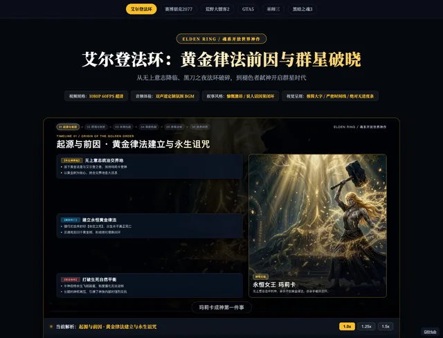 | A collection of narrative films about video games. | [Demo](https://elden-ring-lore.xiaosang.cc/) · [Repo](https://github.com/holynova/elden-ring-lore) |
| Elden Ring · Chronicles of the Lands Between | 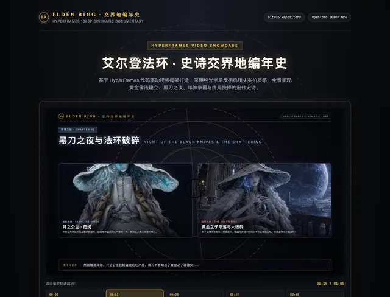 | A video account of the events and characters of the Lands Between. | [Demo](https://elden-ring-lore-video.xiaosang.cc/) · [Repo](https://github.com/holynova/elden-ring-lore-video) |
| Folk Gallery | 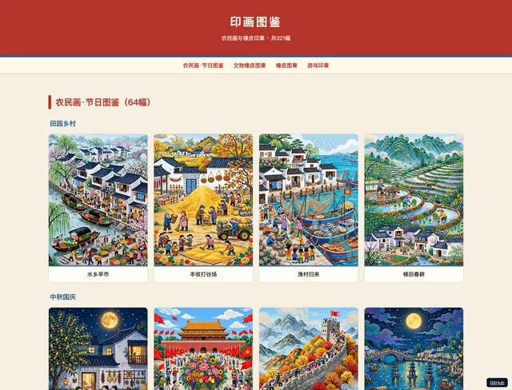 | 321 folk paintings and stamp artworks with thumbnail browsing, full-resolution lightboxes and keyboard navigation. | [Demo](https://folk-gallery.xiaosang.cc/) · [Repo](https://github.com/holynova/folk-gallery) |
| Crossover Folk Gallery | 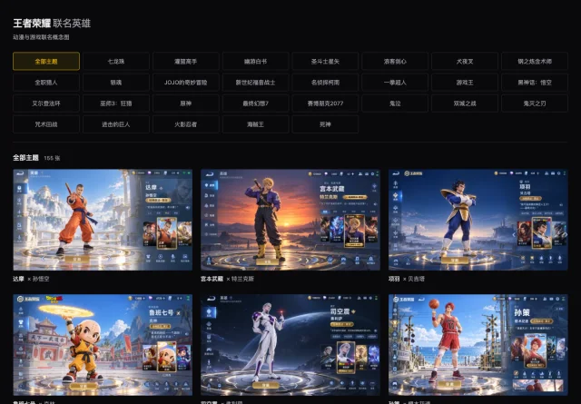 | 155 Honor of Kings crossover concepts, 28 theme filters, fullscreen previews and original-image ZIP downloads. | [Demo](https://crossover-folk-gallery.xiaosang.cc/) · [Repo](https://github.com/holynova/crossover-folk-gallery) |
| The Creation Variants | 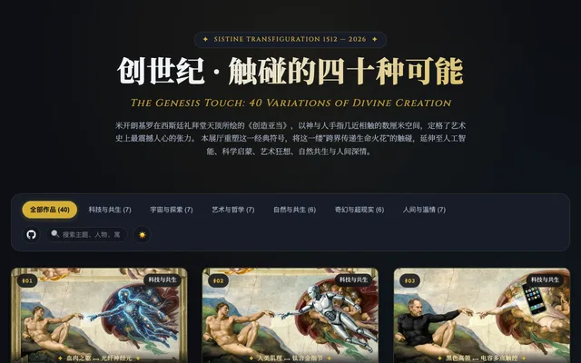 | The Genesis Touch: 40 Variations of Divine Creation paying homage to Michelangelo's Sistine ceiling masterpiece with progressive image loading and dual theme aesthetics | [Demo](https://the-creation-variants.xiaosang.cc/) · [Repo](https://github.com/holynova/the-creation-variants) |
| Elden Ring Liveaction |  | A photography-style AI image gallery reimagining Elden Ring, Cyberpunk 2077 and Zelda. | [Demo](https://elden-ring-liveaction.xiaosang.cc/) · [Repo](https://github.com/holynova/elden-ring-liveaction) |
| Karpathy Deep Explainer Artifacts | 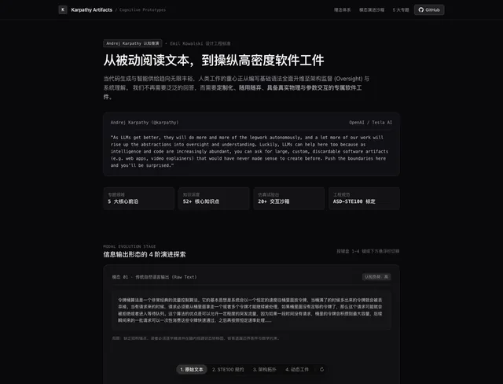 | Interactive learning artifacts for frontend systems, distributed design, prompts and creator insights. | [Demo](https://karpathy-deep-explainer-artifacts.xiaosang.cc/) · [Repo](https://github.com/holynova/karpathy-deep-explainer-artifacts) |
| Battle City Roguelike | 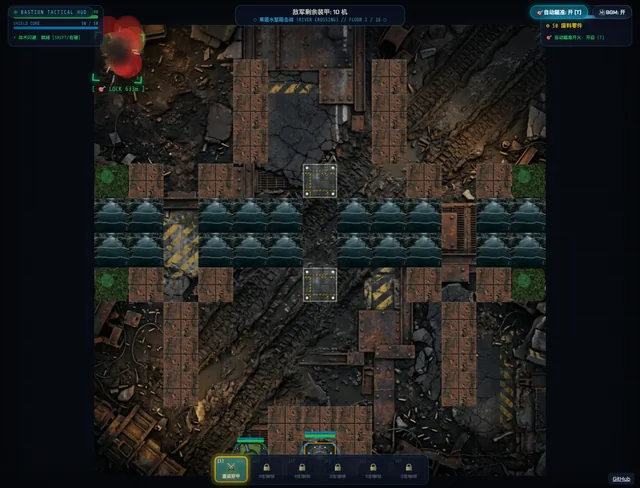 | A browser tank roguelite combining base defense, elemental weapons and campaign upgrades. | [Demo](https://battle-city-roguelike.xiaosang.cc/) · [Repo](https://github.com/holynova/battle-city-roguelike) |
| Hearthstone Match | 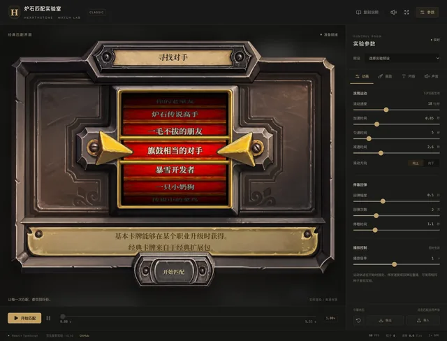 | An adjustable React matchmaking recreation with spinner motion, sparks and synthesized audio. | [Demo](https://hearthstone-match.xiaosang.cc/) · [Repo](https://github.com/holynova/hearthstone-match) |
| Builder Atlas | 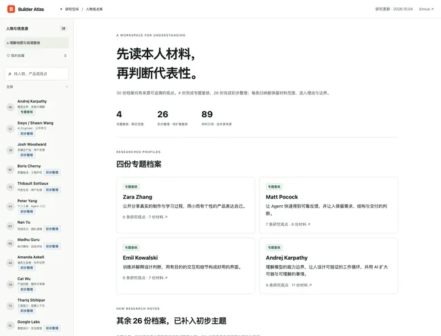 | A source-bound reading workbench for 30 builders, with reading paths, bookmarks and notes. | [Demo](https://builder-atlas.xiaosang.cc/) · [Repo](https://github.com/holynova/builder-atlas) |
| Fallwell | 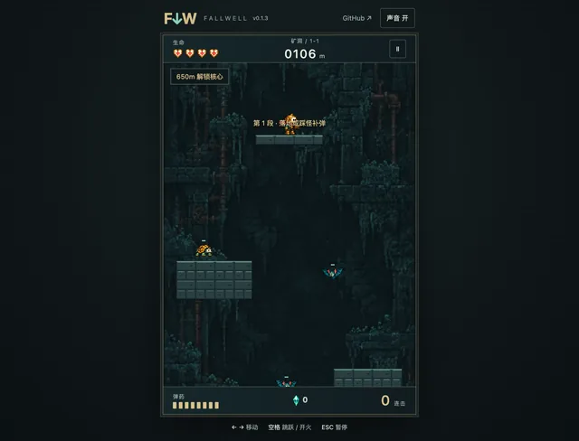 | A descent roguelite with shot-assisted falls, stomp combos, reloads, cores and relic builds. | [Demo](https://fallwell.xiaosang.cc/) · [Repo](https://github.com/holynova/fallwell) |
| Rift Survivors | 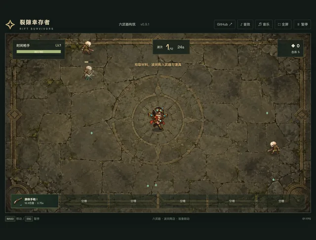 | A browser survival arena with independent weapons, contact melee and between-wave shops. | [Demo](https://rift-survivors.xiaosang.cc/) · [Repo](https://github.com/holynova/rift-survivors) |
| System Design Algorithms Js | 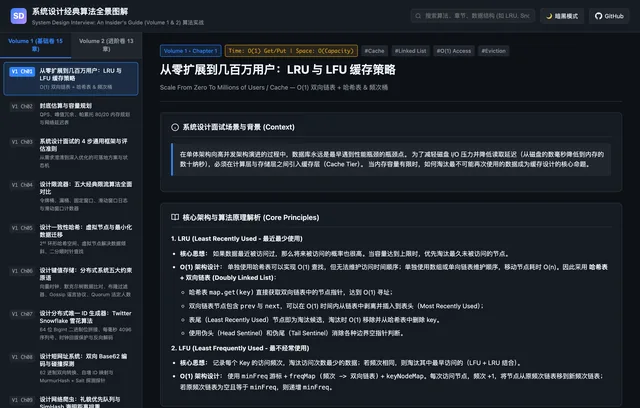 | Classic system design algorithms from Alex Xu's System Design Interview (28 chapters) implemented in vanilla JS, featuring SVG architecture diagrams, Mermaid workflows, and interactive playgrounds | [Demo](https://xiaosang.cc/system-design-algorithms-js/) · [Pages](https://holynova.github.io/system-design-algorithms-js/) · [Repo](https://github.com/holynova/system-design-algorithms-js) |
| Image Gallery Template | 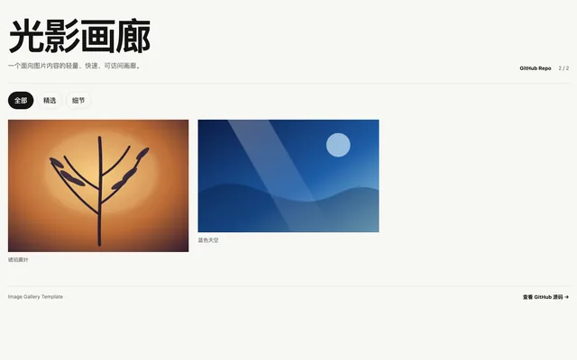 | AI-native image gallery template that turns a theme and a folder of images into a shippable static site with Sharp processing, validation, Umami analytics, and deployment guidance | [Demo](https://xiaosang.cc/image-gallery-template/) · [Pages](https://holynova.github.io/image-gallery-template/) · [Repo](https://github.com/holynova/image-gallery-template) |
| Rubber Stamp World Cities | 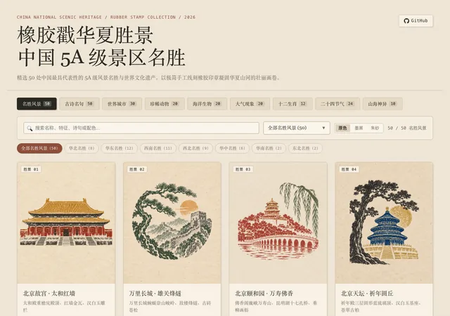 | Rubber Stamp Art: 350 prints across 13 collections, with journal collage, stamp collection, ex-libris workshops and ink palettes | [Demo](https://holynova.github.io/rubber-stamp-world-cities/) · [Repo](https://github.com/holynova/rubber-stamp-world-cities) |
| City Stamp | 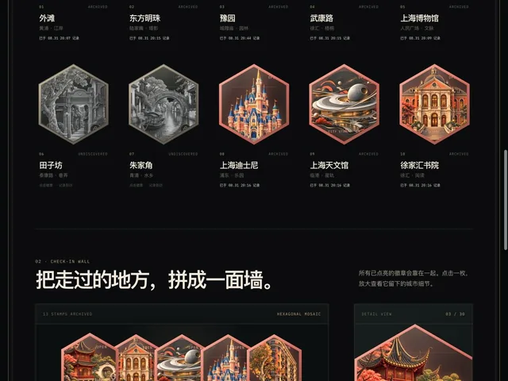 | City Stamp: a 40-landmark check-in archive for Shanghai, Suzhou, Beijing, and Hangzhou with illuminated hexagonal badges | [Demo](https://holynova.github.io/city-stamp/) · [Repo](https://github.com/holynova/city-stamp) |
| Daily Necessities Library |  | A Wander masonry library with 116 unbranded product PNGs and 21 still-life collections, search, favorites, sharing, and original downloads | [Demo](https://daily-necessities-library.xiaosang.cc/) · [Repo](https://github.com/holynova/daily-necessities-library) |
| Art Style Showcase | 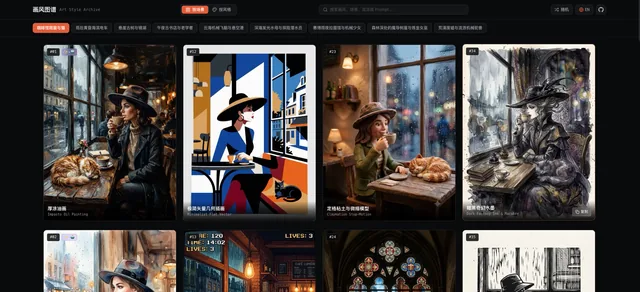 | Art Style Archive: Visual taxonomy of 14 art movements across 9 benchmark scenes with side-by-side comparison | [Demo](https://holynova.github.io/art-style-showcase/) · [Repo](https://github.com/holynova/art-style-showcase) |
| Shanghai Through Walls |  | Evidence-backed Shanghai architectural cutaway atlas distinguishing verified structure from constrained inference | [Demo](https://holynova.github.io/shanghai-through-walls/) · [Repo](https://github.com/holynova/shanghai-through-walls) |
| Print Atlas |  | Interactive atlas of printmaking, halftone reproduction, and CMYK overprinting | [Demo](https://holynova.github.io/print-atlas/) · [Repo](https://github.com/holynova/print-atlas) |
| Game Style Transfer Atlas |  | Compare 15 game visual styles, prompts, and 16:9 landscape transfers from three city photos | [Demo](https://holynova.github.io/game-style-transfer-atlas/) · [Repo](https://github.com/holynova/game-style-transfer-atlas) |
| Health Book |  | Personal and family health knowledge management and medication guide | [Demo](https://holynova.github.io/health-book/) · [Repo](https://github.com/holynova/health-book) |
| Poem Formula |  | Structural formula and rhyming pattern breakdown for classical poetry | [Demo](https://holynova.github.io/poem-formula/) · [Repo](https://github.com/holynova/poem-formula) |
| System Design Learning Lab |  | System design workbook: hands-on KV replication, Snowflake IDs and URL shortening, with concept maps and recall exercises | [Demo](https://holynova.github.io/system-design-learning-lab/) · [Repo](https://github.com/holynova/system-design-learning-lab) |
| Hotpot Timer |  | Cinematic Three.js countdown with one-letter-at-a-time A–Z transformations | [Demo](https://holynova.github.io/hotpot-timer/) · [Repo](https://github.com/holynova/hotpot-timer) |
| Citypop Shanghai Exploration |  | Rough-grain City Pop painting and prompt archive exploring Shanghai and Beijing | [Demo](https://holynova.github.io/citypop-shanghai-exploration/) · [Repo](https://github.com/holynova/citypop-shanghai-exploration) |
| Gushi Namer |  | Classical Chinese poetry baby namer (2200+ GitHub Stars) | [Demo](https://holynova.github.io/gushi_namer/) · [Repo](https://github.com/holynova/gushi_namer) |
| Psy Talks |  | Mobile practice roadmap for counseling microskills, with v1 drills and v2 reader | [Demo](https://holynova.github.io/psy-talks/) · [Repo](https://github.com/holynova/psy-talks) |
| Kaleidoscope Studio |  | Interactive kaleidoscope generator with draggable triangular sampling | [Demo](https://holynova.github.io/kaleidoscope-studio/) · [Repo](https://github.com/holynova/kaleidoscope-studio) |
| Flash Card |  | Mobile-first spaced repetition memory flashcards PWA application | [Demo](https://holynova.github.io/flash-card/) · [Repo](https://github.com/holynova/flash-card) |
| Win98 Screen Saver |  | Web-based interactive reproduction of classic Windows 95/98 screen savers | [Demo](https://holynova.github.io/win98-screen-saver/) · [Repo](https://github.com/holynova/win98-screen-saver) |
| Ai Gallery |  | Static image gallery with grid/list views, instant search, and dark mode | [Demo](https://ai-gallery.xiaosang.cc/) · [Repo](https://github.com/holynova/ai-gallery) |
| Text Book Pics |  | Digital archive and visual reconstruction of classic textbook illustrations | [Demo](https://holynova.github.io/text_book_pics/) · [Repo](https://github.com/holynova/text_book_pics) |
| 24Points |  | Solutions for the 24 Game with all 1,820 four-card combinations | [Demo](https://holynova.github.io/24points/) · [Repo](https://github.com/holynova/24points) |
| Director Motorcycle Cinema |  | Cinema-styled gallery of director-inspired motorcycle photography | [Demo](https://holynova.github.io/director-motorcycle-cinema/) · [Repo](https://github.com/holynova/director-motorcycle-cinema) |
| Card 3D Depth Lab |  | Interactive CSS 3D card with parallax depth layers and pointer transforms | [Demo](https://holynova.github.io/card-3d-depth-lab/) · [Repo](https://github.com/holynova/card-3d-depth-lab) |
| Ask All Ai |  | Side-by-side streaming comparison of ChatGPT, Gemini, Grok, and DeepSeek responses | [Demo](https://holynova.github.io/ask_all_ai/) · [Repo](https://github.com/holynova/ask_all_ai) |
| Wenwu Checkin |  | Mobile catalog of 195 Chinese cultural relics prohibited from overseas exhibition | [Demo](https://holynova.github.io/wenwu-checkin/) · [Repo](https://github.com/holynova/wenwu-checkin) |
| Xiaoyuzhou Transcript Downloader |  | CLI tool to batch download Xiaoyuzhou FM podcast episode lists and transcripts | [Demo](https://holynova.github.io/xiaoyuzhou-transcript-downloader/) · [Repo](https://github.com/holynova/xiaoyuzhou-transcript-downloader) |
| Hand Fireworks |  | Interactive Canvas particle fireworks animation triggered by gestures | [Demo](https://holynova.github.io/hand_fireworks/) · [Repo](https://github.com/holynova/hand_fireworks) |
| Cut And Remix |  | Web-based digital photo weaving and image deconstruction art tool | [Demo](https://holynova.github.io/cut_and_remix/) · [Repo](https://github.com/holynova/cut_and_remix) |
| Raytracing Demo |  | Pure Web micro raytracing renderer demonstration in JavaScript | [Demo](https://holynova.github.io/raytracing-demo/) · [Repo](https://github.com/holynova/raytracing-demo) |
| Emoji Life Timeline |  | Trace a life through an illustrated timeline of emoji. | [Demo](https://holynova.github.io/life_emoji/) · [Repo](https://github.com/holynova/life_emoji) |
| Mouse Scroll Heath Check |  | Mouse scroll wheel health, drift, and accuracy testing tool | [Demo](https://holynova.github.io/mouse_scroll_heath_check/) · [Repo](https://github.com/holynova/mouse_scroll_heath_check) |
| Industry Book Recommender |  | Curated 170 books from 2747 comments with discipline filtering and search | [Demo](https://holynova.github.io/industry-book-recommender/) · [Repo](https://github.com/holynova/industry-book-recommender) |
| Ai Agent Interview Report |  | AI Agent interview evaluation metrics and capability analysis dashboard | [Demo](https://holynova.github.io/ai-agent-interview-report/) · [Repo](https://github.com/holynova/ai-agent-interview-report) |
| Texas Holdem Hand Probability |  | Offline exact Texas Hold'em final hand probability calculator | [Demo](https://holynova.github.io/texas-holdem-hand-probability/) · [Repo](https://github.com/holynova/texas-holdem-hand-probability) |
| Poetry Flow |  | Interactive visualization of poetic flow and imagery connections | [Demo](https://holynova.github.io/poetry-flow/) · [Repo](https://github.com/holynova/poetry-flow) |
| 50 Seeds |  | Reference library of 24 categories × 50 visual seed parameters for AI imagery | [Demo](https://holynova.github.io/50-seeds/) · [Repo](https://github.com/holynova/50-seeds) |
| Chrome Session Tui |  | macOS terminal TUI for inspecting and closing Chrome automation sessions | [Demo](https://holynova.github.io/chrome-session-tui/) · [Repo](https://github.com/holynova/chrome-session-tui) |
| Tiny Icons |  | Online icon generator and exporter for Chrome extensions and Favicons | [Demo](https://holynova.github.io/tiny-icons/) · [Repo](https://github.com/holynova/tiny-icons) |
| Multi Screen View |  | Synchronize responsive interactions across multiple iPhone-sized Chrome windows | [Demo](https://holynova.github.io/multi-screen-view/) · [Repo](https://github.com/holynova/multi-screen-view) |
| Xieyin |  | Chinese homophone words and pun generator lookup tool | [Demo](https://holynova.github.io/xieyin/) · [Repo](https://github.com/holynova/xieyin) |
| Flash Words |  | Browser-based kinetic typography arranging and video/GIF exporter | [Demo](https://holynova.github.io/flash-words/) · [Repo](https://github.com/holynova/flash-words) |
| Brand Etymology |  | Etymology, pronunciation evolution, and cultural background of global brands | [Demo](https://holynova.github.io/brand-etymology/) · [Repo](https://github.com/holynova/brand-etymology) |
| City Public Facilities |  | Proximity search for urban cultural, transit, medical, and community facilities | [Demo](https://holynova.github.io/city-public-facilities/) · [Repo](https://github.com/holynova/city-public-facilities) |
| Json Workbench Extension |  | Chrome extension for structured JSON visual editing, validation, and conversion | [Demo](https://holynova.github.io/json-workbench-extension/) · [Repo](https://github.com/holynova/json-workbench-extension) |
| Game Rating Lookup |  | Aggregated rating and release date lookup for console and indie video games | [Demo](https://holynova.github.io/game-rating-lookup/) · [Repo](https://github.com/holynova/game-rating-lookup) |
| Mobile Sensor Playground |  | Mobile gyroscope and accelerometer hardware sensor API interaction playground | [Demo](https://holynova.github.io/mobile-sensor-playground/) · [Repo](https://github.com/holynova/mobile-sensor-playground) |
| Mercator Country Compare |  | Interactive map comparing true country surface areas without Mercator distortion | [Demo](https://holynova.github.io/mercator-country-compare/) · [Repo](https://github.com/holynova/mercator-country-compare) |
| Js Go Compare |  | Side-by-side reference handbook comparing JavaScript and Go syntax | [Demo](https://holynova.github.io/js-go-compare/) · [Repo](https://github.com/holynova/js-go-compare) |
| Github Pages Detector Extension |  | Chrome extension detecting active GitHub Pages for repositories automatically | [Demo](https://holynova.github.io/github-pages-detector-extension/) · [Repo](https://github.com/holynova/github-pages-detector-extension) |
| Collection Miner |  | Chrome extension that resurfaces forgotten bookmarks on each new tab | [Repo](https://github.com/holynova/collection_miner) |
| Char Finder |  | Mobile Chinese rhyme lookup tool with pinyin and tone analysis | [Demo](https://holynova.github.io/char_finder/) · [Repo](https://github.com/holynova/char_finder) |
| Web Motion Showcase |  | Modern web UI motion gallery with 30 animations and AI prompts | [Demo](https://holynova.github.io/web-motion-showcase/) · [Repo](https://github.com/holynova/web-motion-showcase) |
| My Design System |  | Personal frontend design system specifications, color palettes & components | [Demo](https://holynova.github.io/my-design-system/) · [Repo](https://github.com/holynova/my-design-system) |
| Spinning Drawer |  | Interactive spirograph curve generator with circular and polygonal stators | [Demo](https://holynova.github.io/spinning-drawer/) · [Repo](https://github.com/holynova/spinning-drawer) |
| Photo Align |  | Face alignment and animated MP4/GIF timeline timelapse exporter | [Demo](https://holynova.github.io/photo_align/) · [Repo](https://github.com/holynova/photo_align) |
| Image Local Llm |  | Local AI image generation workbench with batch queue, history, and gallery | [Demo](https://holynova.github.io/image_local_llm/) · [Repo](https://github.com/holynova/image_local_llm) |
| Bookshelf Manager |  | AI-powered app to catalog physical books via photo and browse on a 3D virtual shelf | [Demo](https://holynova.github.io/bookshelf_manager/) · [Repo](https://github.com/holynova/bookshelf_manager) |
| Video Prompt Generator |  | Bilingual AI video generation prompt builder using structured templates | [Demo](https://holynova.github.io/video_prompt_generator/) · [Repo](https://github.com/holynova/video_prompt_generator) |
| Job Offer Comparison |  | Compare job offers side by side. | [Demo](https://holynova.github.io/offer_compare/) · [Repo](https://github.com/holynova/offer_compare) |
| Scrape To Markdown.Chrome |  | Chrome side-panel extension to save web content as Markdown and export media | [Repo](https://github.com/holynova/scrape-to-markdown.chrome) |
| Keyboard Sentence |  | iOS keyboard adaptive layout simulator with typing animation and video export | [Demo](https://holynova.github.io/keyboard_sentence/) · [Repo](https://github.com/holynova/keyboard_sentence) |
| Prompt One By One |  | Chrome extension for sequential batch prompt generation on Gemini and AI platforms | [Repo](https://github.com/holynova/prompt_one_by_one) |
| Tank Tactics Game |  | Pixel-art land and sea tactics with distinct factions, animated tracks and artillery, local PvP and AI | [Demo](https://tank-tactics-game.xiaosang.cc/) · [Repo](https://github.com/holynova/tank-tactics-game) |
| Haiku Flow |  | Swipe-card interface for discovering, reading, and collecting poetry | [Demo](https://holynova.github.io/haiku-flow) · [Repo](https://github.com/holynova/haiku-flow) |
| One Second Movie |  | Generate 4K video contact sheets — see an entire movie at a glance | [Demo](https://holynova.github.io/one_second_movie/) · [Repo](https://github.com/holynova/one_second_movie) |
| Json To Ts |  | Infer and generate TypeScript interface definitions from JSON data | [Demo](https://holynova.github.io/json_to_ts/) · [Repo](https://github.com/holynova/json_to_ts) |
| 生命时间轴可视化 | - | 甘特图展示生命时间线 | [Repo](https://github.com/holynova/life_bar_chart) |
| Typepress · Equal-width Posters |  | Fit each line of text to the same width. Choose a font and layout, then copy the typeset text or save a high-resolution poster. | [Demo](https://equal-width.xiaosang.cc/) · [Repo](https://github.com/holynova/equal_width) |
| String Alchemy |  | String transformations, encoding/decoding, and hash calculators | [Demo](https://holynova.github.io/string_alchemy/) · [Repo](https://github.com/holynova/string_alchemy) |
| Head Tail Poem |  | Acrostic poem card generator and elegant Chinese layout tool | [Demo](https://holynova.github.io/head_tail_poem/) · [Repo](https://github.com/holynova/head_tail_poem) |
| Sorting Algorithm Playground |  | Watch the steps of a sorting algorithm. | [Demo](https://holynova.github.io/algorithm/show_sort/index.html) · [Repo](https://github.com/holynova/algorithm) |
| YouTube Content Capture |  | Capture video content from YouTube. | - |
| 100 Clocks |  | A curated collection of 100 clocks in distinct interactive styles | [Demo](https://holynova.github.io/100-clocks) · [Repo](https://github.com/holynova/100-clocks) |
| Pre Tax Salary Calculator |  | Calculate pre-tax salary from post-tax income for the Chinese tax system | [Demo](https://holynova.github.io/pre_tax_salary_calculator/) · [Repo](https://github.com/holynova/pre_tax_salary_calculator) |
| Combinations and Permutations |  | Calculate and visualize permutations and combinations. | [Demo](https://holynova.github.io/combination/) · [Repo](https://github.com/holynova/combination) |
| Holiday Visualizer |  | Mainland China holiday calendar with make-up workdays and month-by-month leave plans | [Demo](https://holiday-visualizer.xiaosang.cc/) · [Repo](https://github.com/holynova/holiday-visualizer) |
| Music Pulse |  | Music rhythm visualizer driven by audio envelope curve animations | [Demo](https://holynova.github.io/music_pulse/) · [Repo](https://github.com/holynova/music_pulse) |
| OpenCLI 流水线 | - | 基于 OpenCLI 调度的本地串行 AI 内容生成流水线 | [Repo](https://github.com/holynova/opencli-pipeline) |
| Anthropic Learn Assets |  | SVG icons and color palette assets extracted from Anthropic's Learn pages | [Demo](https://holynova.github.io/anthropic-learn-assets/) · [Repo](https://github.com/holynova/anthropic-learn-assets) |
| 小红书自动化发布 | - | 小红书图文发布自动化工具：支持批量排程、拼图封面与防检测 | [Repo](https://github.com/holynova/auto-xiao-hong-shu) |
| Notebooklm One By One |  | Automated NotebookLM slide deck and social media post generator | [Repo](https://github.com/holynova/notebooklm_one_by_one) |
| Head Tail Poem Generator |  | Classical Chinese acrostic and end-rhyme poem generator and layout tool | [Demo](https://holynova.github.io/head_tail_poem_generator/) · [Repo](https://github.com/holynova/head_tail_poem_generator) |
| Pdf2Wechat |  | Pure frontend PDF to long image stitcher for mobile sharing | [Demo](https://holynova.github.io/pdf2wechat/) · [Repo](https://github.com/holynova/pdf2wechat) |
| Douban Quark Clawer |  | Automated tool to find Quark cloud drive links for Douban wishlist movies | [Demo](https://holynova.github.io/douban-quark-clawer/) · [Repo](https://github.com/holynova/douban-quark-clawer) |
| Ui Compare Privacy Policy |  | Bilingual privacy policy page for UI Compare Chrome extension | [Demo](https://holynova.github.io/ui-compare-privacy-policy/) · [Repo](https://github.com/holynova/ui-compare-privacy-policy) |
