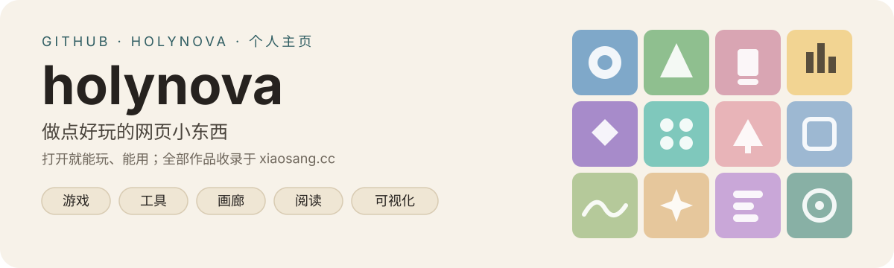
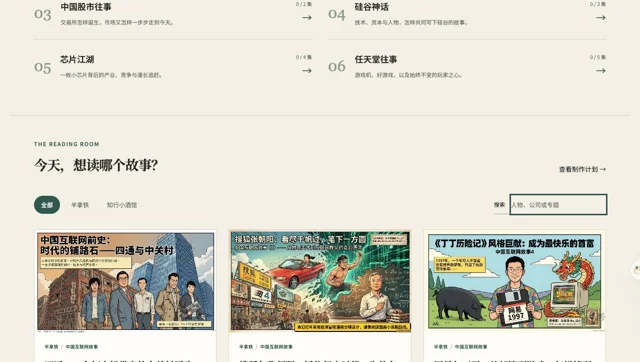
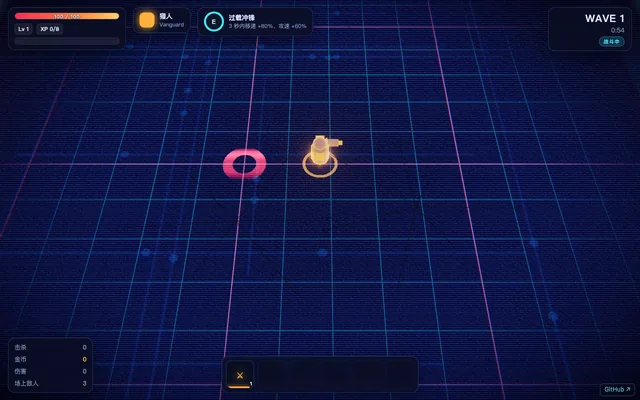
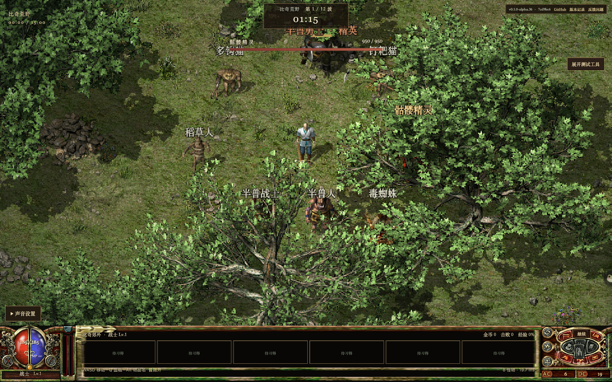
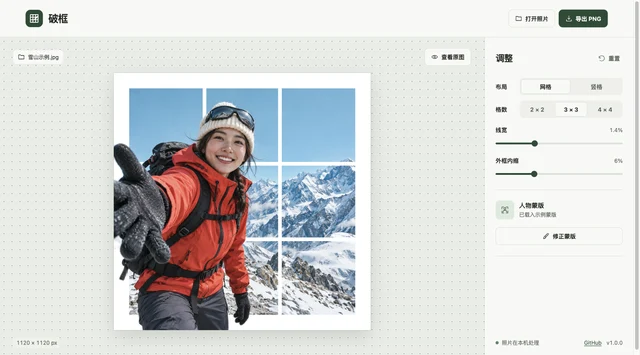
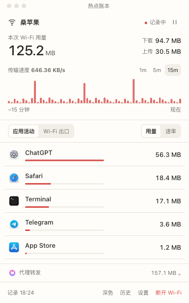
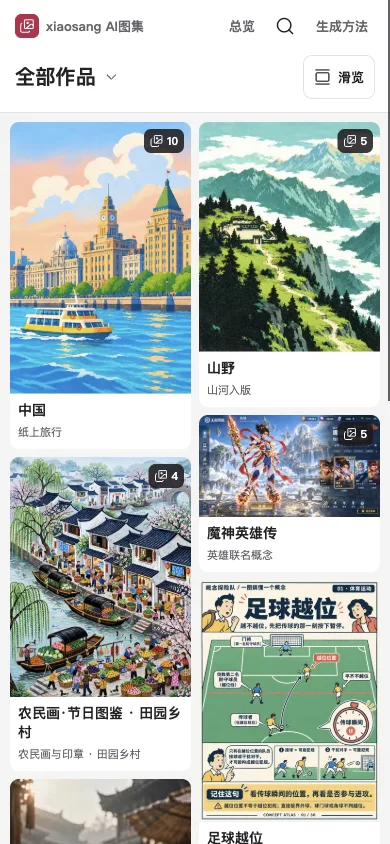
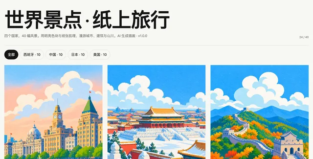
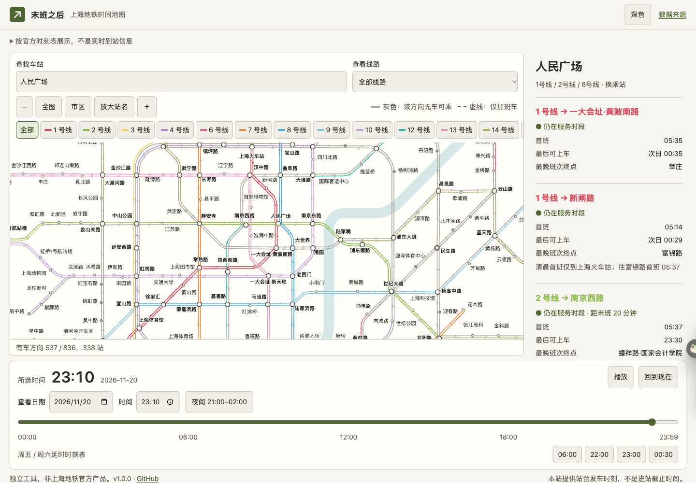
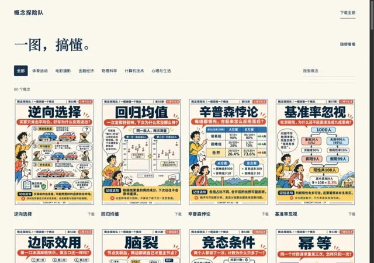

<a href="README.md">中文</a>

  

  <a href="https://xiaosang.cc/">Portfolio</a>
  ·
  <a href="https://github.com/holynova?tab=repositories">All Repositories</a>

Hello, I'm holynova. I build small things for the web — games, tools, galleries, reading experiences and visualizations, mostly zero-build static pages that just work when you open them. Everything lives at [xiaosang.cc](https://xiaosang.cc/).

## Stats

## Featured Projects

The full catalog (140+ projects) lives at [xiaosang.cc](https://xiaosang.cc/); here are the highlights in each area.

### Learning & Reading

| Project | Preview | About | Links |
|---|---|---|---|
| 吴军 · 专题学习 (Wu Jun Study Topics) |  | 42 study topics across 14 of Wu Jun's courses, with 17 Chinese comic-style illustrated guides (15 pages each), search, source tracing, and PDF downloads. | [Demo](https://xiaosang.cc/wujun-study/) · [Repo](https://github.com/holynova/wujun-study) |
| 经典书导读 (Forty Classic Books) |  | In-depth guides to classic books: the big idea, the key ideas, and a walkthrough of each book's structure — all substance, in plain words. | [Demo](https://xiaosang.cc/forty-classic-books/) · [Repo](https://github.com/holynova/forty-classic-books) |
| 伯恩斯坦《青少年音乐会》 (Bernstein's Young People's Concerts) |  | All 53 lessons in a two-column guide: key ideas and live demonstrations explained, full-text search and category filters, Bilibili Chinese-subtitled videos, and collapsible listening lists. | [Demo](https://xiaosang.cc/bernstein-ypc/) · [Repo](https://github.com/holynova/bernstein-ypc) |
| 播客图解 (Podcast Atlas) |  | Understand the Ban Latte and Zhixing Tavern podcasts by topic, with timelines, people maps, and Chinese comic slideshows. | [Demo](https://xiaosang.cc/podcast-atlas/) · [Repo](https://github.com/holynova/podcast-atlas) |

### Games

| Project | Preview | About | Links |
|---|---|---|---|
| 植物幸存者 (Plant Survivors) |  | A three-level garden survival game: frame-by-frame character animation, hits and deaths, plant evolution, boss slams, combat sound effects and music. | [Demo](https://xiaosang.cc/plant-survivors-ui/) · [Repo](https://github.com/holynova/plant-survivors-ui) |
| 霓虹幸存者 (Neon Survivors) |  | A Three.js 3D top-down survivor Roguelite, with procedurally generated models and sound. | [Demo](https://xiaosang.cc/neon-survivors/) · [Repo](https://github.com/holynova/neon-survivors) |
| 玛法幸存者 (Mafa Survivor) |  | Three classes (warrior, mage, Taoist), 33 skills with six levels of growth, ten chapters of maps, and gear builds. Alpha; balancing is ongoing. | [Demo](https://xiaosang.cc/mafa-survivor/) · [Repo](https://github.com/holynova/mafa-survivor) |
| 24 点求解器 (24 Solver) |  | A single-file web 24-point card solver: pick your own cards or deal randomly, with exhaustive expression search and associativity dedup, plus foil card faces and sound effects. | [Demo](https://xiaosang.cc/24-solver/) · [Repo](https://github.com/holynova/24-solver) |

### Tools

| Project | Preview | About | Links |
|---|---|---|---|
| 破框 (Photo Breakout) |  | Local automatic background removal — add a white grid or vertical bars behind the subject, then export as PNG. | [Demo](https://xiaosang.cc/photo-breakout/) · [Repo](https://github.com/holynova/photo-breakout) |
| 照片足迹 (Photo Atlas) |  | Scans your local photos to build a city footprint map, a cross-year photo report, and shareable footprint cards. | [Demo](https://xiaosang.cc/photo-atlas/) · [Repo](https://github.com/holynova/photo-atlas) |
| 拼页 (Pingye) |  | Make personal posters, product overviews, or city guides with nine layouts, with image cropping and high-res PNG export. | [Demo](https://xiaosang.cc/pingye/) · [Repo](https://github.com/holynova/pingye) |
| 热点账本 (Hotspot Ledger) |  | Mac hotspot traffic tracking: interface usage, per-process activity ranking, anomaly alerts, and resume after restart. | [Demo](https://xiaosang.cc/hotspot-ledger/) · [Repo](https://github.com/holynova/hotspot-ledger) |

### Galleries & Art

| Project | Preview | About | Links |
|---|---|---|---|
| xiaosang AI 图集 (xiaosang AI Gallery) |  | 22 series, 3,666 AI images, with multi-image posts, immersive swipe browsing, and reusable generation prompts and a Skill. | [Demo](https://xiaosang.cc/xiaosang-gallery/) · [Repo](https://github.com/holynova/xiaosang-gallery) |
| 印画图鉴 (Folk & Stamp Gallery) |  | 321 folk paintings and stamp plates; the grid loads thumbnails, the lightbox shows full-res originals, with keyboard navigation. | [Demo](https://folk-gallery.xiaosang.cc/) · [Repo](https://github.com/holynova/folk-gallery) |
| 山河入版 (Woodblock Landscape Gallery) |  | 185 multicolor woodcut-style AI paintings — landscapes, landmarks, daily life, festivals, and five scenes each of eleven cities — with categories, zoom, and downloads. | [Demo](https://shanhe-gallery.xiaosang.cc/) · [Repo](https://github.com/holynova/shanhe-gallery) |
| 世界景点 · 纸上旅行 (World Landmarks) |  | A paper-textured flat gouache gallery: 5 coastal-summer and 5 varied landscapes, plus 10 sights from each of five countries (including Korea) — 60 in all — with categories, full-image preview, and original downloads. | [Demo](https://world-landmarks.xiaosang.cc/) · [Repo](https://github.com/holynova/world-landmarks) |

### Data & Visualization

| Project | Preview | About | Links |
|---|---|---|---|
| 末班之后 (Shanghai Metro Night) |  | A fullscreen metro time map that auto-plays the day's first and last trains, with event danmaku and light/dark modes. | [Demo](https://xiaosang.cc/shanghai-metro-night/) · [Repo](https://github.com/holynova/shanghai-metro-night) |
| 概念探险队 (Concept Atlas) |  | 60 vertical knowledge comics, each explaining the mechanism behind a term in one picture, with categories, search, and original downloads. | [Demo](https://xiaosang.cc/concept-atlas/) · [Repo](https://github.com/holynova/concept-atlas) |
| Token Theater · 速度体验实验室 (Token Theater) |  | Experience an LLM's output speed, time-to-first-token, and streaming rhythm side by side on phone, terminal, web, and desktop interfaces. | [Demo](https://xiaosang.cc/token-theater/) · [Repo](https://github.com/holynova/token-theater) |
| 古诗文起名 (Classical Poetry Naming) |  | Baby names from the Book of Songs, Songs of Chu, and Tang and Song poetry. | [Demo](https://holynova.github.io/gushi_namer/) · [Repo](https://github.com/holynova/gushi_namer) |

## Recently

- **铁甲夹击 (Iron Flank)** — two-on-one turn-based tank tactics: on an 8×8 board, two tanks trap one to destroy it by focus fire; 10 maps, an 8-level campaign, vs-AI and local 2-player. [Play online](https://holynova.github.io/iron-flank/) · [Repo](https://github.com/holynova/iron-flank)
- **坦克要塞 (Rogue Bastion)** — a tank roguelite: defend the base through 16 floors, 6 elemental main guns unlocking by floor, permanent arsenal upgrades, and a floor-16 boss fight. [Play online](https://holynova.github.io/rogue-bastion/) · [Repo](https://github.com/holynova/rogue-bastion)

## Stack & Interests

- **Mostly frontend**: JavaScript, Canvas / Three.js, zero-build static sites, mobile-first.
- **Also**: Chrome extensions, CLI tools, Node scripts.
- **Interests**: games, music, poetry, cities, AI-generated imagery.
