

  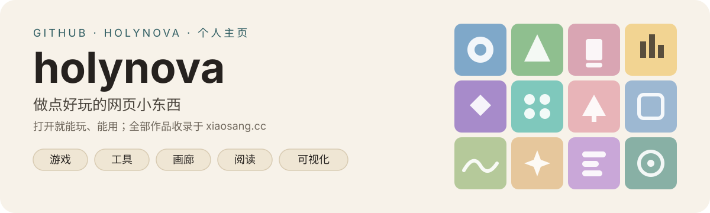

  <a href="https://xiaosang.cc/">作品集 Portfolio</a>
  ·
  <a href="https://github.com/holynova?tab=repositories">全部仓库 All Repos</a>

你好，我是 holynova。我做网页小东西——游戏、工具、画廊、阅读与可视化，大多是零构建的静态页面，打开就能玩、能用。全部作品收录在 [xiaosang.cc](https://xiaosang.cc/)。

Hello, I'm holynova. I build small things for the web — games, tools, galleries, reading experiences and visualizations, mostly zero-build static pages that just work when you open them. Everything lives at [xiaosang.cc](https://xiaosang.cc/).

## 概况 / Stats

## 代表作品 / Featured Projects

140+ 个作品的完整目录见 [xiaosang.cc](https://xiaosang.cc/)，下面是各方向的代表作。

### 学习与阅读 / Learning & Reading

| 项目 | 预览 | 简介 | 链接 |
|---|---|---|---|
| 吴军 · 专题学习 | 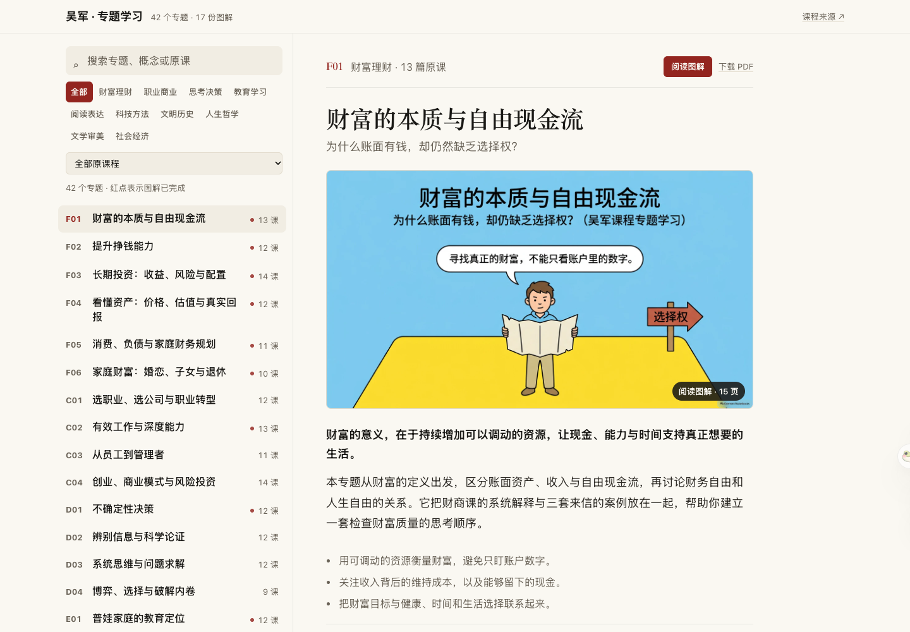 | 吴军 14 门课程的 42 个学习专题，含 17 份中文漫画图解，每份 15 页，支持搜索、出处追溯与 PDF 下载。 | [Demo](https://xiaosang.cc/wujun-study/) · [Repo](https://github.com/holynova/wujun-study) |
| 经典书导读 · Forty Classic Books | 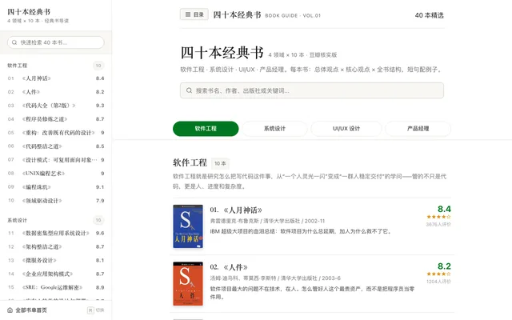 | 经典书深度导读：总体观点、核心观点与全书结构剖析，纯干货说人话。 | [Demo](https://xiaosang.cc/forty-classic-books/) · [Repo](https://github.com/holynova/forty-classic-books) |
| 伯恩斯坦《青少年音乐会》 · Young People's Concerts | 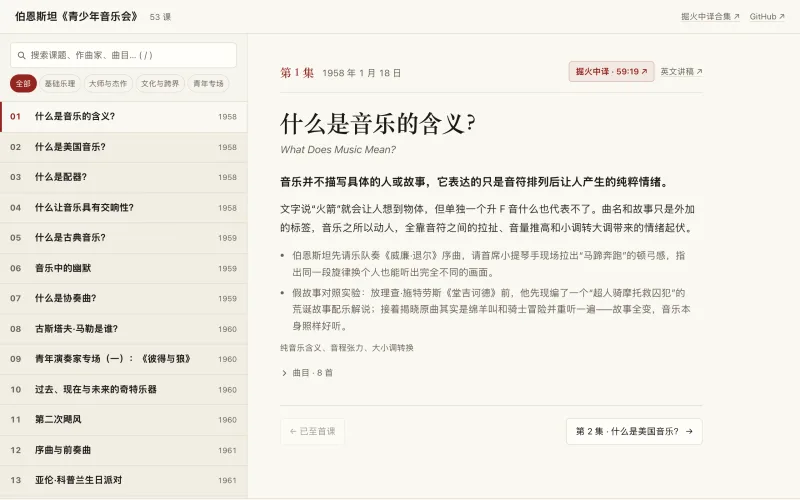 | 全 53 课双栏导览：核心观点与现场实验精讲、全文搜索与分类筛选、B 站掘火中译视频与可折叠试听曲目单。 | [Demo](https://xiaosang.cc/bernstein-ypc/) · [Repo](https://github.com/holynova/bernstein-ypc) |
| 播客图解 · Podcast Atlas | 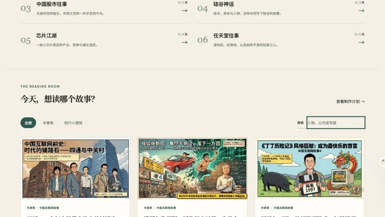 | 按专题读懂半拿铁与知行小酒馆，搭配时间线、人物关系和中文漫画幻灯片。 | [Demo](https://xiaosang.cc/podcast-atlas/) · [Repo](https://github.com/holynova/podcast-atlas) |

### 游戏 / Games

| 项目 | 预览 | 简介 | 链接 |
|---|---|---|---|
| 植物幸存者 · Plant Survivors |  | 三关花园生存游戏：逐帧角色动作、受击与死亡、植物进化、首领重击、战斗音效与配乐。 | [Demo](https://xiaosang.cc/plant-survivors-ui/) · [Repo](https://github.com/holynova/plant-survivors-ui) |
| 霓虹幸存者 · Neon Survivors | 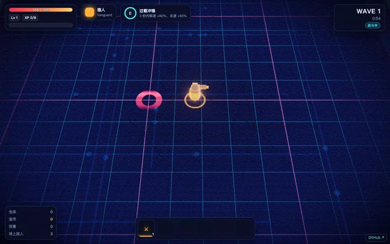 | Three.js 三维俯视角类幸存者 Roguelite，模型与音效程序化生成。 | [Demo](https://xiaosang.cc/neon-survivors/) · [Repo](https://github.com/holynova/neon-survivors) |
| 玛法幸存者 · Mafa Survivor | 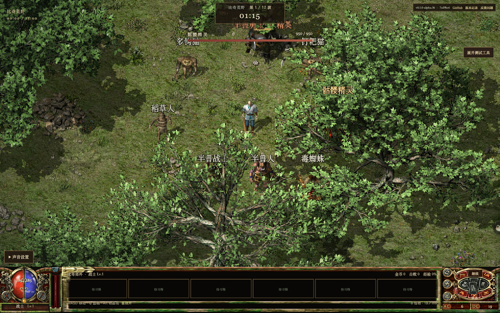 | 战法道三职业、33 种技能六级成长、十章地图与装备构筑；Alpha 版，平衡持续完善。 | [Demo](https://xiaosang.cc/mafa-survivor/) · [Repo](https://github.com/holynova/mafa-survivor) |
| 24 点求解器 · 24 Solver |  | 单文件网页版 24 点纸牌求解器：自定义选牌或随机发牌，穷举算式与结合律去重，配流光牌面与音效。 | [Demo](https://xiaosang.cc/24-solver/) · [Repo](https://github.com/holynova/24-solver) |

### 工具 / Tools

| 项目 | 预览 | 简介 | 链接 |
|---|---|---|---|
| 破框 · Photo Breakout | 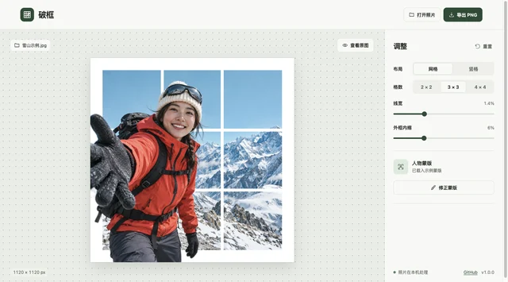 | 本地自动抠像，给人物身后加上白色网格或竖格，再导出 PNG。 | [Demo](https://xiaosang.cc/photo-breakout/) · [Repo](https://github.com/holynova/photo-breakout) |
| 照片足迹 · Photo Atlas | 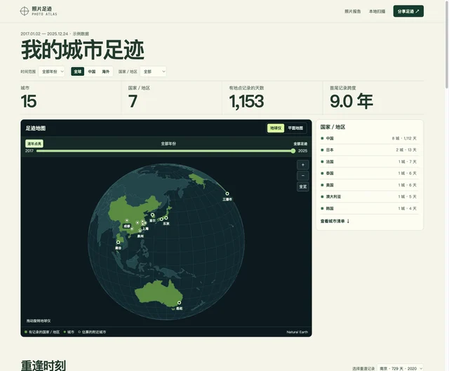 | 扫描本地照片，生成城市足迹地图、跨年照片报告和足迹分享卡。 | [Demo](https://xiaosang.cc/photo-atlas/) · [Repo](https://github.com/holynova/photo-atlas) |
| 拼页 · Pingye |  | 用九种版式制作个人海报、产品速览或城市导览，支持图片裁剪和高清 PNG 导出。 | [Demo](https://xiaosang.cc/pingye/) · [Repo](https://github.com/holynova/pingye) |
| 热点账本 · Hotspot Ledger | 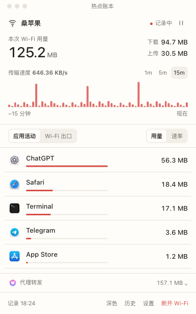 | Mac 热点流量记录：网卡用量、进程活动排行、异常提醒与重启续接。 | [Demo](https://xiaosang.cc/hotspot-ledger/) · [Repo](https://github.com/holynova/hotspot-ledger) |

### 画廊与艺术 / Galleries & Art

| 项目 | 预览 | 简介 | 链接 |
|---|---|---|---|
| xiaosang AI 图集 | 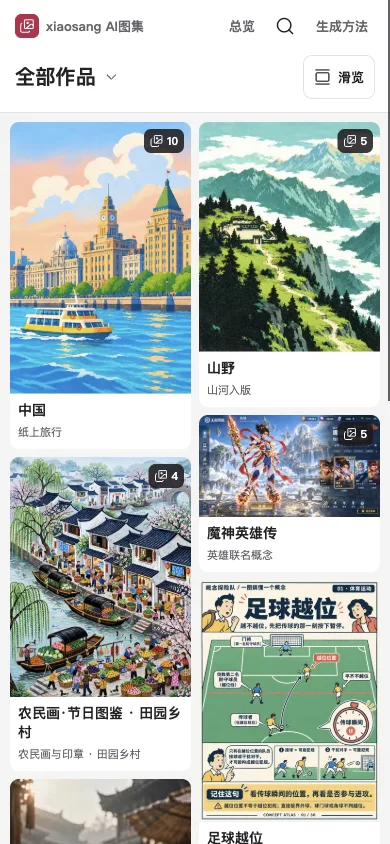 | 22 个系列、3,666 张 AI 图像作品，支持多图帖、沉浸滑览，以及可复用的生成提示词与 Skill。 | [Demo](https://xiaosang.cc/xiaosang-gallery/) · [Repo](https://github.com/holynova/xiaosang-gallery) |
| 印画图鉴 · Folk & Stamp Gallery | 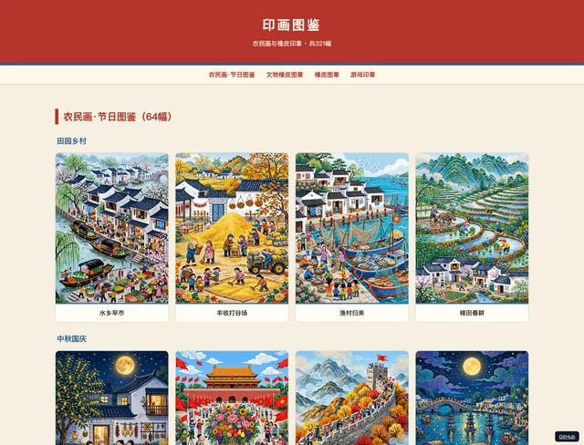 | 321 幅农民画与印章图鉴，网格加载缩略图，灯箱显示高清原图，支持键盘切换。 | [Demo](https://folk-gallery.xiaosang.cc/) · [Repo](https://github.com/holynova/folk-gallery) |
| 山河入版 · 套色木刻画廊 | 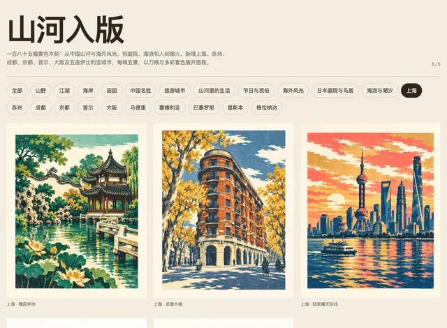 | 185 张套色木刻风格 AI 画作，涵盖山河、名胜、生活、节日与十一城五景，支持分类、放大和下载。 | [Demo](https://shanhe-gallery.xiaosang.cc/) · [Repo](https://github.com/holynova/shanhe-gallery) |
| 世界景点 · 纸上旅行 | 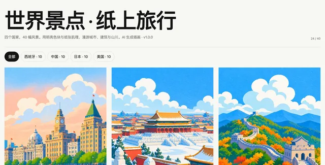 | 纸纹平涂水粉画廊：海岸夏日与多样风景各 5 张，五国景点各 10 张（含韩国），共 60 张，支持分类、整图预览和原图下载。 | [Demo](https://world-landmarks.xiaosang.cc/) · [Repo](https://github.com/holynova/world-landmarks) |

### 数据与可视化 / Data & Visualization

| 项目 | 预览 | 简介 | 链接 |
|---|---|---|---|
| 末班之后 · Shanghai Metro Night | 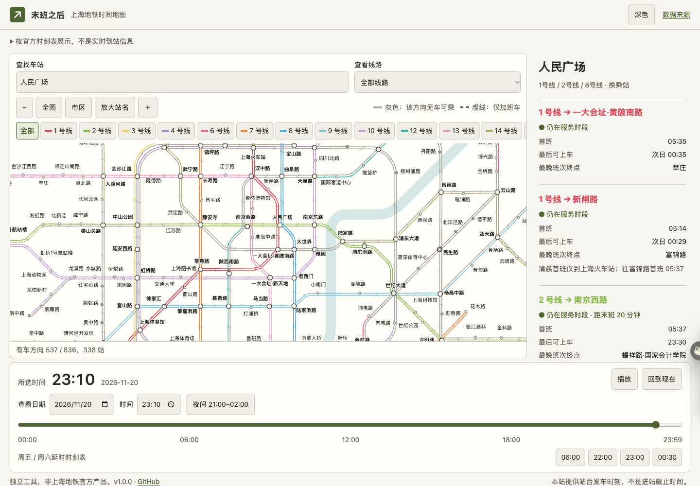 | 全屏地铁时间地图，自动放映收发车过程，配事件弹幕与浅深色模式。 | [Demo](https://xiaosang.cc/shanghai-metro-night/) · [Repo](https://github.com/holynova/shanghai-metro-night) |
| 概念探险队 · Concept Atlas | 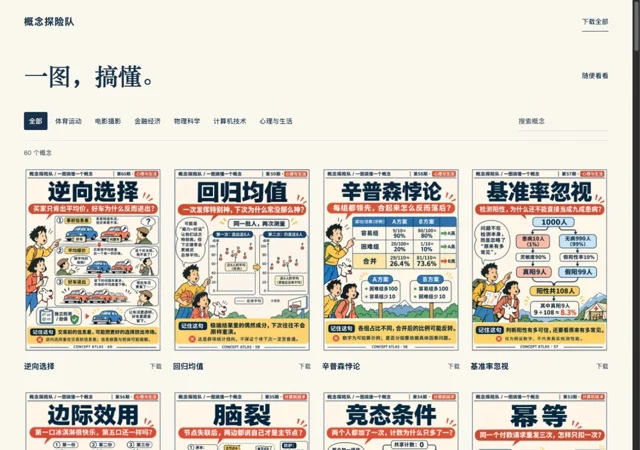 | 60 张竖版知识漫画，一图解释术语背后的机制，支持分类、搜索与原图下载。 | [Demo](https://xiaosang.cc/concept-atlas/) · [Repo](https://github.com/holynova/concept-atlas) |
| Token Theater · 速度体验实验室 | 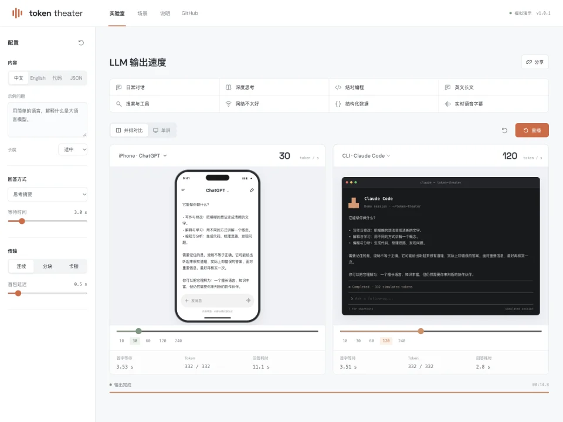 | 在手机、终端、网页和桌面界面并排体验大模型的输出速度、首字等待和流式节奏。 | [Demo](https://xiaosang.cc/token-theater/) · [Repo](https://github.com/holynova/token-theater) |
| 古诗文起名 | 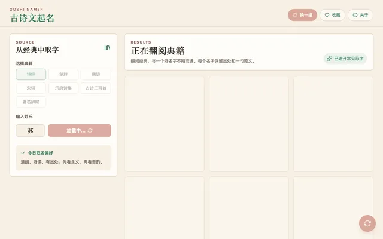 | 诗经楚辞唐诗宋词起名。 | [Demo](https://holynova.github.io/gushi_namer/) · [Repo](https://github.com/holynova/gushi_namer) |

## 最近更新 / Recently

- **铁甲夹击 Iron Flank** — 二打一回合制坦克战棋：8×8 棋盘，两辆夹一辆集火击毁；10 张地图、8 关战役、人机与双人对战。[在线玩](https://holynova.github.io/iron-flank/) · [仓库](https://github.com/holynova/iron-flank)
- **坦克要塞 Rogue Bastion** — 坦克 Roguelite：守卫基地打穿 16 层，6 种元素主炮按楼层解锁，军械库永久升级，第 16 层 Boss 战。[在线玩](https://holynova.github.io/rogue-bastion/) · [仓库](https://github.com/holynova/rogue-bastion)

## 技术与兴趣 / Stack & Interests

- **前端为主**：JavaScript、Canvas / Three.js，零构建静态站，移动端优先。
- **也做**：Chrome 扩展、CLI 小工具、Node 脚本。
- **兴趣**：游戏、音乐、诗歌、城市、AI 生成图像。

## English

**holynova** builds small things for the web — games, tools, galleries, reading experiences and visualizations, mostly zero-build static pages. The full catalog (140+ projects) lives at [xiaosang.cc](https://xiaosang.cc/).

- **Learning & reading**: Wu Jun study topics, classic-books guides, Bernstein's Young People's Concerts, podcast atlas.
- **Games**: Plant Survivors, Neon Survivors, Mafa Survivor, 24 Solver — plus the newest tank games, Iron Flank (turn-based focus-fire tactics) and Rogue Bastion (tank roguelite).
- **Tools**: Photo Breakout (local background removal), Photo Atlas, Pingye (poster maker), Hotspot Ledger.
- **Galleries & art**: xiaosang AI gallery (3,666 images), folk & stamp gallery, woodblock-style landscapes, world landmarks in watercolor.
- **Data & visualization**: Shanghai metro night map, concept atlas, Token Theater, classical-poetry baby naming.
- **Stack**: JavaScript, Canvas / Three.js, zero-build static sites, mobile-first; also Chrome extensions, CLI tools and Node scripts.
